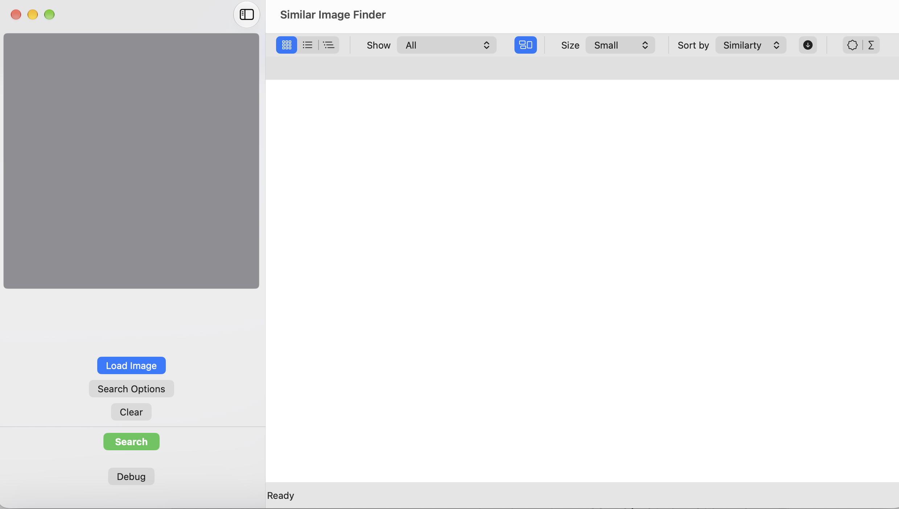
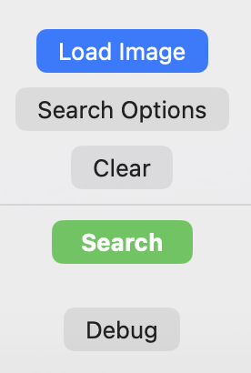
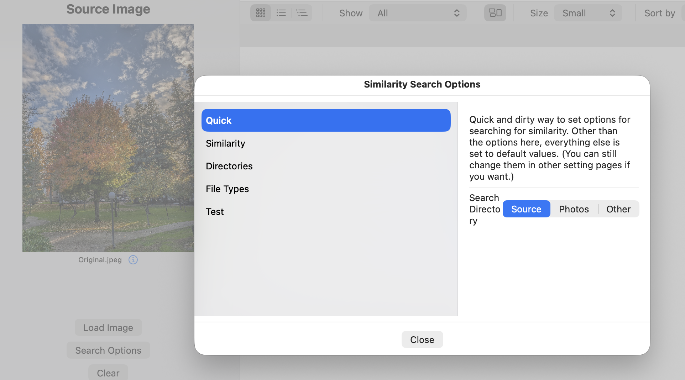
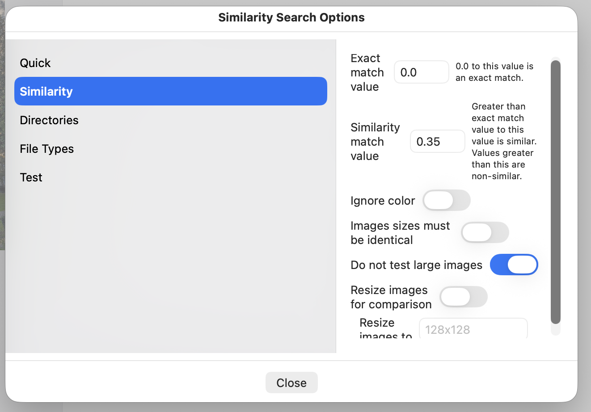
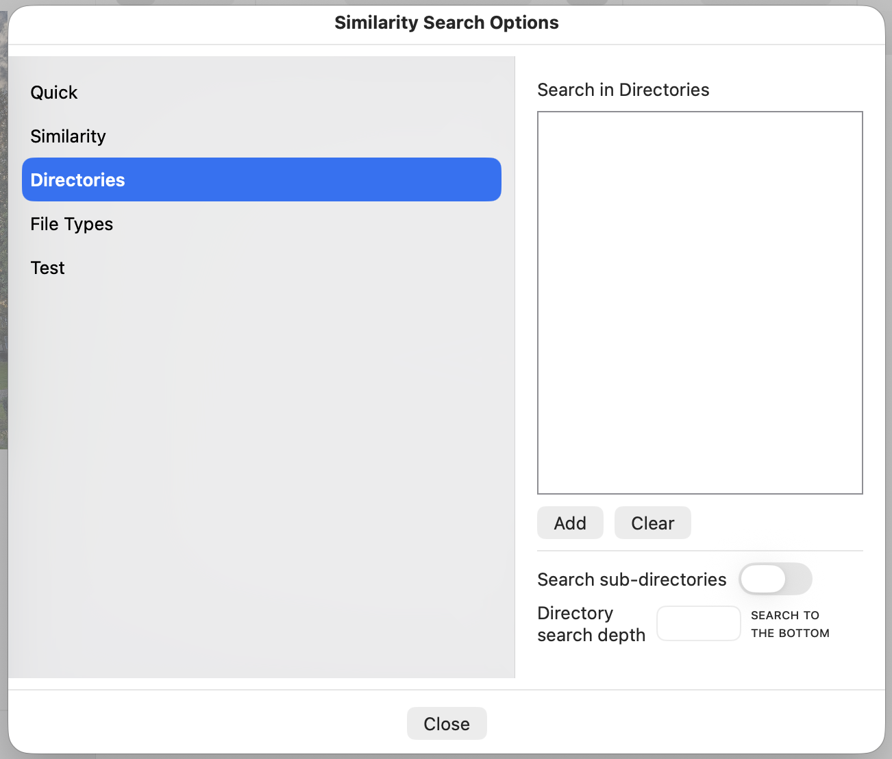
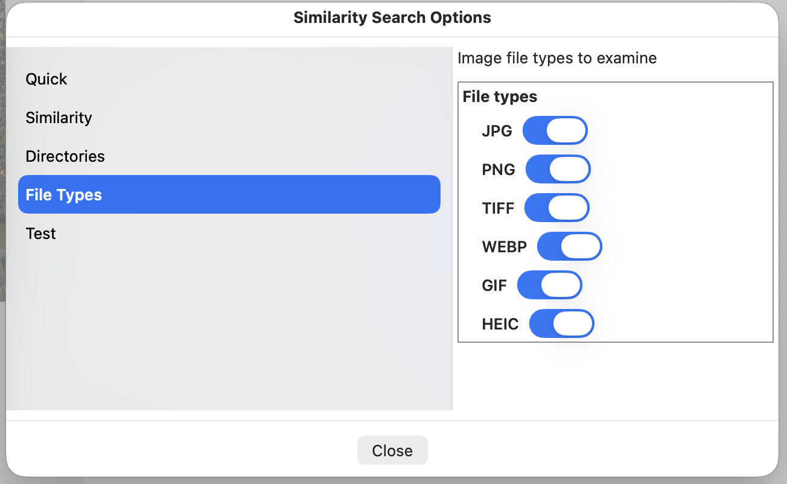
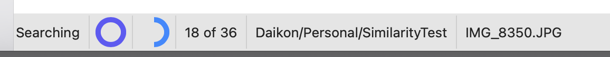
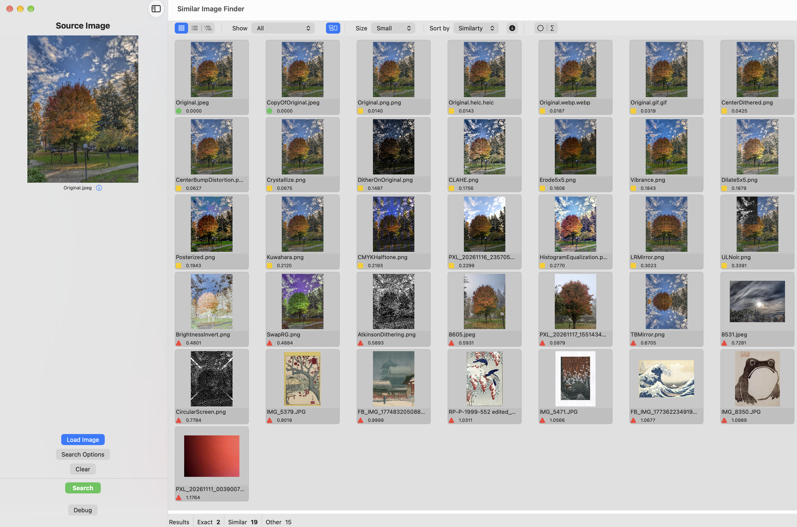
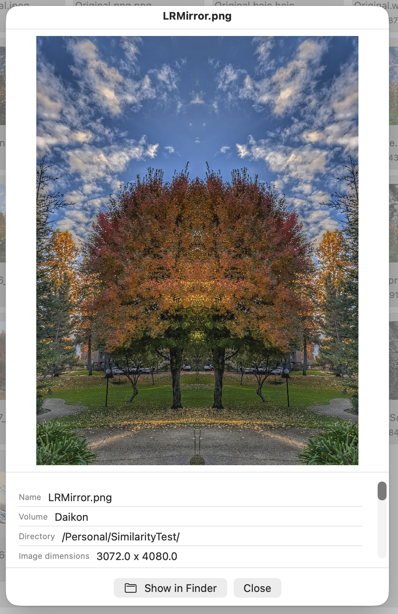
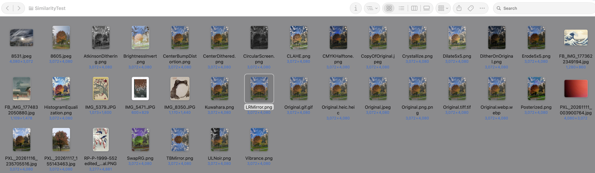

# DeskImageFinder
Stuart Rankin\
June 2026\
(Updated November 2026)

## Summary
This program allows users to search for similar images to a given image. Similarity is determined by Apple's Vision API.

The user selects and image, then a directory to search in (and sub-directories if desired), then starts the search. All images will be displayed with a score (where **1.0** is an exact match) and a thumbail of the image.

### Naming
This is the desktop version of the image finder. Work on the mobile version was postponed pending other projects with a higher priority.

## User Interface
The user interface (see below) is straightforward.

To start searching for similar issues, the user will tap on **Load Image** and use the standard interface to select the image to search for.

The image above shows the controls for searching. Once the image to search for is selected, it will appear in the view over the controls. The user can select Search Options. (If the user does not, standard options will be used.)

### Search Options
There are four sets of search options (plus a deprecated Test option).

#### Quick

Here the user can specify a search directory - there are three options:
1. Source (default) - the directory of the source image is used as the root directory for searching.
2. Photos - search the Photos library.
3. Other - the user can point the program to any other directory that is available.

#### Similarity
This set of settings controls how similarity is defined when searching. Similarity is defined by a value from **0.0** (exact match) to **1.0** (no similarity found) and ranges in between.

##### Exact Match Value
This value determines exact matches. Defaults to **0.0** meaning exact matches must really be exact.
##### Similarity Match Value
This is the top-end of the range that determines another image is similar (but not exact) to the image being searched for. Defaults to **0.35**.
##### Ignore Color
Tells the Vision API to ignore color when determining similarity. Defaults to **off** (eg, color is used).
##### Images Sizes Must Be Identical
If true, only images of the same size as the image being search for are examined. Defaults to **off**.
##### Do Not Test Large Images
Large images are not examined. Large is defined as any image whose height or width is greater than 10,000 pixels. This is to allow for faster processing - Vision slows down a lot with large images.
##### Resize Images for Comparison
Resize images to the specified size for comparison. If you specify a relatively small size, this will speed up processing at the expense of false positives.

#### Directories

Here you set the directories you want to search for similar images. Tap Add to add a directory, or Clear to remove directories. To search sub-directories of your set of direcrories, turn on **Search Sub-Directories**. **Directory Search Depth** limits how deep the similarity search will go in sub-directories. If you enable **Search to the Bottom**, the search will descend until there are no more sub-directories.

#### File Types

Here the user selected the file types to look at when looking for similar images. Any file type not in this list is not supported.

#### Test
Development tests. Not intended to be used by the user.

### Clear
Clears seach options and search results.

### Search
Once you set your options, tap Search to start the search.

### Debug
Not intended for use by the user.

## Searching
Once the user starts a search, the status bar at the bottom will show progress.

When searching, there are six sections:

### Action
Shows the action, in this case, "Searching".

### Directory Percent Complete
Shows, in graphical form, the percent of directories to search that have been completed or are in progress. In this example, there was only one directory so the percent complete is 100%.

### Files in Directory Percent Complete, Graphical
In graphical form, the percent of files that have been measured for similarity.

### Files in Directory Percent Complete, Numeric
In numeric form, the percent of files that have been measured for simulatiry.

### Current Directory
The path of the current directory being looked at.

### File Name
Name of the file being measured.

## Search Results.
Once the search is complete, DeskImageFinder will show a grid of images, sorted in how similar the image is to the original.

All images searched will be in the grid of images. Under each image is the file name, and under that, an icon and a number. A green circle means exact match. A yellow square is a similar match. A red triangle is everything else (and recall you can change similarity matches in the options).

If you double-click an image in the results window, you will see information about the image, including physical attributes, EXIF data, and the like (use the scroll bar near the bottom to scroll through the information).

Clicking on the **Show in Finder** button will open a Finder window with the image in question highlighted.

